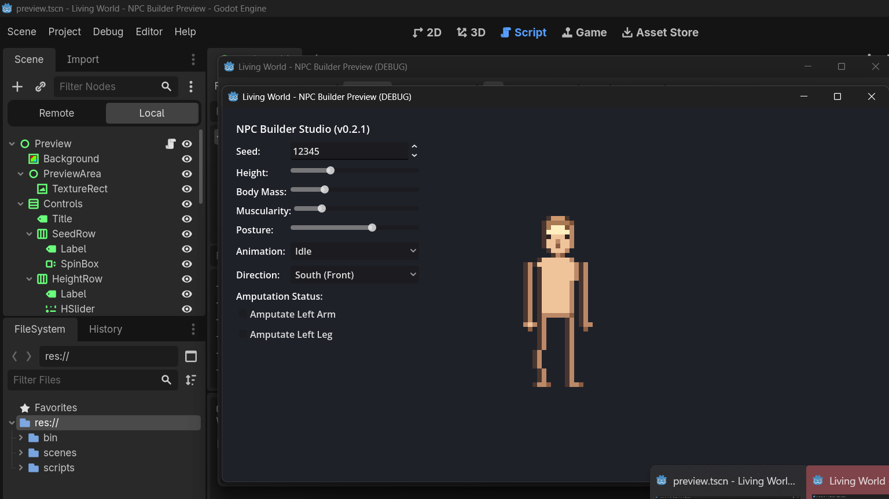

# Living World — Procedural NPC Builder


[](https://en.wikipedia.org/wiki/C%2B%2B20)
[](https://godotengine.org/)
[](https://github.com/subhan-sd/npc-builder/actions/workflows/ci.yml)
[]()

> **Living World NPC Builder** adalah sistem generator karakter piksel prosedural deterministik berbasis **C++20** untuk simulasi dunia dinamis, dilengkapi preview studio interaktif di **Godot 4.x** melalui **GDExtension**.

---

## 📌 Status & Progress Saat Ini

**Versi Terkini:** `v0.2.3` — *GDExtension Architecture Migration & C++ Single Source of Truth*  
**Fase Saat Ini:** Migrasi penuh dari generator GDScript duplikat ke modul native GDExtension C++ terverifikasi. C++ Core menjadi satu-satunya sumber kebenaran (*single source of truth*), teruji deterministik lintas platform dengan CTest dan 7.360 golden fixtures.

### 🖼️ Studio Preview (Godot 4.x GDExtension Runtime)



---

## 🚀 Fitur yang Sudah Selesai (Completed)

### 1. Anatomi Piksel Prosedural & Profil Tubuh (v0.2.1)
- **Model Studi Anatomi Netral (Unclothed)**: Menghilangkan render pakaian kaku agar proporsi tubuh dapat diinspeksi secara objektif.
- **Profil Siluet Terkalibrasi (Referensi Klasik)**:
  - **Slim Jim**: Frame ramping, anggota tubuh lebih ramping, celah kaki natural.
  - **Trim Jim**: Proporsi baseline atletis seimbang.
  - **Gym Jim**: Bahu lebar (*broad deltoid*), siluet *V-taper*, kontur dada (*pectoral crease*), dan aksen abdominal.
  - **Chin Jim**: Pinggang dan pinggul lebar, perut membulat (*paunch*).
- **Artikulasi Organik**: Transisi trapezius melandai, takik siku, otot lengan bawah, ibu jari tangan, celah lutut, lengkungan betis lateral, dan tumpuan kaki stabil.

| Slim Jim | Trim Jim | Gym Jim | Chin Jim | Side (Tegak) | Side (Bungkuk) |
| :---: | :---: | :---: | :---: | :---: | :---: |
|  |  |  |  |  |  |

### 2. Deformasi Posture Terpadu (Multi-part Coordinate Shift)
- Slider **Posture** (0.0 - 1.0) menghasilkan deformasi tulang yang selaras:
  - Kemiringan kepala maju (hingga 3px).
  - Kemiringan torso atas maju (hingga 1.5px).
  - Penyesuaian leher dan pergeseran bahu tampak samping (*East/West*).
  - Kompresi trapezius pada tampak depan (*South*).

### 3. Palet Warna Harmonik 5-Tone Ramp
Setiap warna kulit diturunkan menjadi 5 tingkatan kontras:
- `Highlight` -> `Base Tone` -> `Shadow Tone` -> `Deep Crease` -> `Deep Outline`.

### 4. Animasi & Arah Pandang
- **6 State Animasi**: `Idle`, `Walk`, `Run`, `Attack`, `Fall`, `Swim`.
- **4 Arah Pandang**: `South (Front)`, `North (Back)`, `East (Right)`, `West (Left)`.

### 5. Kondisi Fisik & Simulasi Kerusakan
- **Amputasi Cascading**: 10 bagian tubuh (`Head`, `Torso`, `Left/Right Arm`, `Left/Right Hand`, `Left/Right Leg`, `Left/Right Foot`). Jika lengan diamputasi, tangan otomatis tidak dirender.
- **Visual Injuries**: `Cut` / `Blood`, `Bandage` (balutan perban melintang), `Scar` (bekas luka), dan `Bruise` (memar). Semua luka terikat pada koordinat relatif anggota tubuh dan ikut berayun saat animasi.

### 6. C++ Core Single Source of Truth & GDExtension Architecture
- Algoritma C++20 murni dengan alokasi memori terkontrol di `core/src/generator.cpp` sebagai satu-satunya sumber kebenaran (*single source of truth*).
- Integrasi GDExtension native (`extension/` berbasis `godot-cpp`) mendaftarkan kelas `NPCGenerator` ke `ClassDB`.
- Menghilangkan duplikasi logika generator dan rasterizer di GDScript.
- Waktu render C++ inti rata-rata ~1.2 mikrodetik per karakter dengan determinisme 100% terverifikasi melalui matriks 7.360 golden fixture hash FNV-1a.

---

## 🗺️ Roadmap Proyek

- [x] **v0.1**: Baseline flat-rectangle procedural renderer & Godot preview.
- [x] **v0.2**: 5-tone palette ramp, 10 body parts, cascade amputation, physical condition injuries.
- [x] **v0.2.1**: Natural human anatomy, curvilinear torso, articulate limbs, multi-part posture deformation, unclothed preview.
- [x] **v0.2.3**: GDExtension native architecture migration, C++ core single source of truth, C-API v2 with round-trip serializer, Release-proof CTest suite & 7,360 golden fixture matrix.
- [ ] **v0.3**:
  - Profil Anatomi Wanita (*Female body proportions, pelvic/chest variation*).
  - Sistem Layering Pakaian Dinamis (*Modular clothing, armor, and equipment*).
  - Variasi Wajah Lanjutan & Gaya Rambut Modular.
- [ ] **v0.4**:
  - Sistem Penuaan Prosedural (*Aging, wrinkles, hair graying*).
  - Integrasi API C ke Engine C++ untuk simulasi massal (ribuan NPC simultan).

---

## 🛠️ Cara Build & Menjalankan

### Persyaratan
- C++20 Compiler (GCC 13+, Clang 16+, atau MSVC 2022)
- CMake 3.20+
- Godot Engine 4.x (Direkomendasikan 4.3 atau 4.7+)

### 1. Build C++ Core, Tests, & GDExtension
```bash
# Konfigurasi dan compile (Release)
cmake -B build -DCMAKE_BUILD_TYPE=Release
cmake --build build -j

# Jalankan seluruh rangkaian test otomatis CTest
ctest --test-dir build --output-on-failure

# Jalankan benchmark render mikro
./build/benchmark_render
```

### 2. Menjalankan Godot Preview Studio (GDExtension)
1. Pastikan ekstensi `godot/bin/libnpc_builder_extension.so` (Linux) atau `.dll` (Windows) telah terkompilasi melalui CMake.
2. Buka Godot Engine 4.x (res:// project di folder `godot/`).
3. Jalankan scene utama `res://scenes/preview.tscn` (tekan `F5` atau `F6`). Godot otomatis memuat kelas native `NPCGenerator`.

---

## 📂 Struktur Repositori

```text
├── core/
│   ├── include/npc/       # Header C++ (types, appearance, conditions, pixel_buffer, c_api.h)
│   └── src/               # Implementasi C++ authoritative generator, serializer, & C API v2
├── extension/             # Modul native GDExtension (adapter NPCGenerator & register_types)
├── godot/
│   ├── bin/               # Manifest .gdextension & compiled dynamic libraries (.so / .dll)
│   ├── scenes/            # Scene UI Godot (preview.tscn)
│   ├── scripts/           # Script UI & thin GDExtension bridge (npc_bridge.gd)
│   └── project.godot      # Konfigurasi Godot 4.x project
├── tests/
│   ├── test_generator.cpp # Unit test C++ (RNG, posture, silhouettes, amputasi)
│   ├── test_c_api.cpp     # Test kesetaraan 100% byte RGBA C API vs C++ Core
│   ├── test_serializer.cpp# Test round-trip serializer & validasi data rusak
│   ├── test_golden.cpp    # Test regresi 7.360 golden fixture hashes FNV-1a
│   ├── generate_fixtures.cpp # Tool generator fixture acuan
│   └── benchmark_render.cpp  # Microbenchmark kecepatan render (~1.2 us/frame)
├── docs/
│   ├── BRD_NPC_BUILDER_V0.2.1.md
│   ├── BRD_NPC_Builder_GDExtension_dilanjutkan.md
│   ├── LAPORAN_AUDIT_DAN_RENCANA_MIGRASI_GDEXTENSION.md
│   ├── README_v0.2.1.md   # Laporan rilis visual v0.2.1
│   └── references/        # Fixture gambar & screenshot hasil pengujian
└── README.md              # Dokumentasi utama proyek
```

---

## 📄 Lisensi
Bagian dari proyek **Living World Simulation Engine**.
