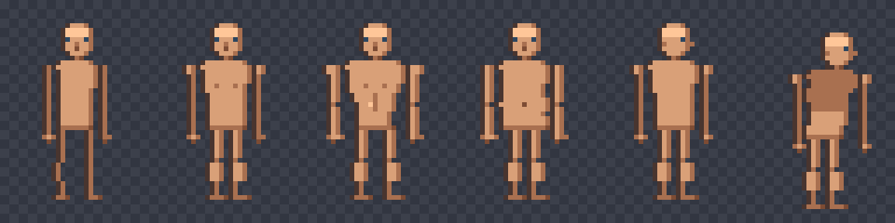
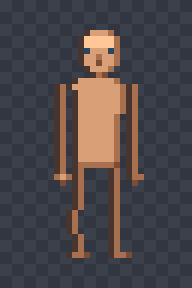
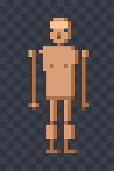
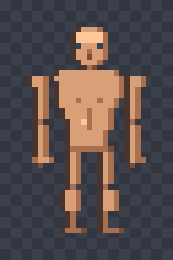
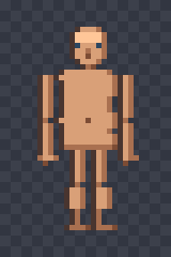
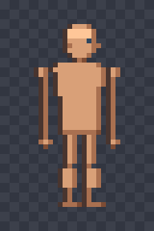
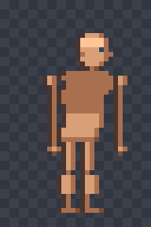
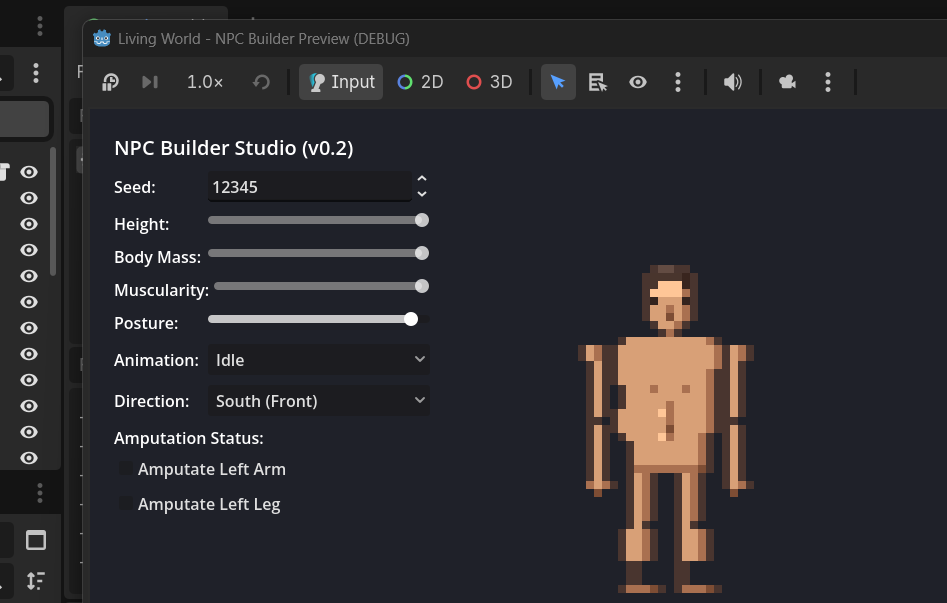

# Living World — NPC Builder v0.2.1
### Visual Anatomy Refinement & Procedural Human Body System



> **Living World NPC Builder** adalah generator karakter prosedural berbasis **C++20** dengan authoritas simulasi deterministik dan preview visual interaktif di **Godot 4.x**.  
> Versi **v0.2.1** menghadirkan pembaruan fundamental: transisi dari siluet kotak geometris v0.1/v0.2 menuju **studi anatomi manusia natural**, terinspirasi dari referensi pixel art klasik (*Trim Jim, Gym Jim, Slim Jim, Chin Jim*).

---

## 📸 Visual Showcase & Studio Preview

### 1. Perbandingan Profil Bentuk Tubuh (*Body Shape Studies*)
Bentuk tubuh diproses secara parametrik matematis dan melengkung (*curvilinear*), bukan sekadar perbesaran skala bitmap:

| Slim Jim (Kurus) | Trim Jim (Standar) | Gym Jim (Berotot) | Chin Jim (Berisi) | Tampak Samping (Tegak) | Tampak Samping (Bungkuk) |
| :---: | :---: | :---: | :---: | :---: | :---: |
|  |  |  |  |  |  |
| Frame ramping, celah kaki natural | Proporsi atletis seimbang | Bahu lebar, *V-taper*, otot pektoral | Pinggang lebar, perut membulat | Postur tulang belakang lurus | Deformasi multi-tulang bungkuk |

---

### 2. NPC Builder Studio — Godot 4 Preview Runtime
Pengujian visual interaktif berjalan langsung di Godot 4.7.2:



- **Parameter Real-time**: `Seed`, `Height`, `Body Mass`, `Muscularity`, dan `Posture`.
- **Dukungan Animasi**: `Idle`, `Walk`, `Run`, `Attack`, `Fall`, `Swim`.
- **4 Arah Pandang**: `South (Front)`, `North (Back)`, `East (Right)`, `West (Left)`.
- **Simulasi Kondisi Fisik**: Amputasi cascading (*Left/Right Limbs*) serta luka (*Cuts, Scars, Bruises, Bandages*).

---

## 🔬 Pembaruan Utama Anatomi v0.2.1

```
              [ CRANIUM & HAIR ]
                      │
            [ TAPERED JAW & CHIN ]
                      │
     ┌──────────[ TRAPEZIUS ]──────────┐
[ DELTOID ]       [ PECTORALS ]       [ DELTOID ]
     │                 │                   │
[ BICEP ]        [ LINEA ALBA ]       [ BICEP ]
     │                 │                   │
  [ ELBOW ]       [ WAIST / PAUNCH ]    [ ELBOW ]
     │                 │                   │
[ FOREARM ]       [ PELVIS/GROIN ]    [ FOREARM ]
     │               ┌───┴───┐             │
  [ WRIST ]     [ THIGH ] [ THIGH ]     [ WRIST ]
     │              │         │            │
  [ HAND ]      [ KNEE ]  [ KNEE ]      [ HAND ]
                [ CALF ]  [ CALF ]
                [ ANKLE]  [ ANKLE]
                [ FOOT ]  [ FOOT ]
```

1. **Model Studi Anatomi Netral (Unclothed)**:
   - Menghilangkan render pakaian blok kaku default agar proporsi tubuh dapat diinspeksi secara objektif sebelum penambahan sistem *clothing layer* di v0.3.
2. **Sistem Palet Harmonik 5-Step Tone Ramp**:
   - `Highlight` -> `Base Tone` -> `Shadow Tone` -> `Deep Crease` -> `Deep Outline`.
   - Menjaga kontras bentuk tanpa menimbulkan *color noise* pada resolusi piksel 32x48.
3. **Torso & Bahu Organik**:
   - Transisi bahu melandai (*trapezius*), garis batas dada (*pectoral crease*), dan lekukan pinggul pelvis yang kokoh.
4. **Artikulasi Ekstremitas**:
   - Lengan: Deltoid mengait natural ke bahu, takik siku, otot lengan bawah, serta ibu jari tangan.
   - Kaki: Paha proporsional, celah lutut, lengkungan betis lateral, dan tumpuan kaki stabil.
5. **Deformasi Posture Terpadu**:
   - Slider `Posture` menggerakkan kepala (hingga 3px ke depan), mencondongkan torso atas (hingga 1.5px), dan memposisikan leher secara selaras di sudut samping (*East/West*).

---

## 🧪 Verifikasi & Status Pengujian

Seluruh logika matematika C++ diuji secara otomatis dengan `./build/npc_test`:

```bash
cmake -B build -S . && cmake --build build && ./build/npc_test
```

```text
Running NPC Builder unit tests...
[PASS] RNG Determinism verified.
[PASS] Body variation & render (424 pixels drawn).
[PASS] Reference 1 silhouettes verified (Slim: 306, Trim: 361, Gym: 404, Chin: 402).
[PASS] Posture deformation verified (Upright max X: 23, Hunched max X: 25).
[PASS] Amputation reduces silhouette (440 -> 389).
[PASS] Physical condition injury rendered correctly.
[PASS] All 6 animation states x 4 directions rendered successfully.
[PASS] Serialization & deserialization verified.
All NPC Builder core tests passed successfully!
```

---

## 🗺️ Roadmap Menuju v0.3

- [x] Baseline flat-box v0.1
- [x] Reference 1 palette & 10 body parts v0.2
- [x] **Natural human anatomy & unclothed preview v0.2.1**
- [ ] Profil Anatomi Wanita (*Female Body Proportions & Silhouettes*)
- [ ] Sistem Layer Pakaian Dinamis (*Modular Clothing & Armor*)
- [ ] Variasi Rambut & Fitur Wajah Lengkap
